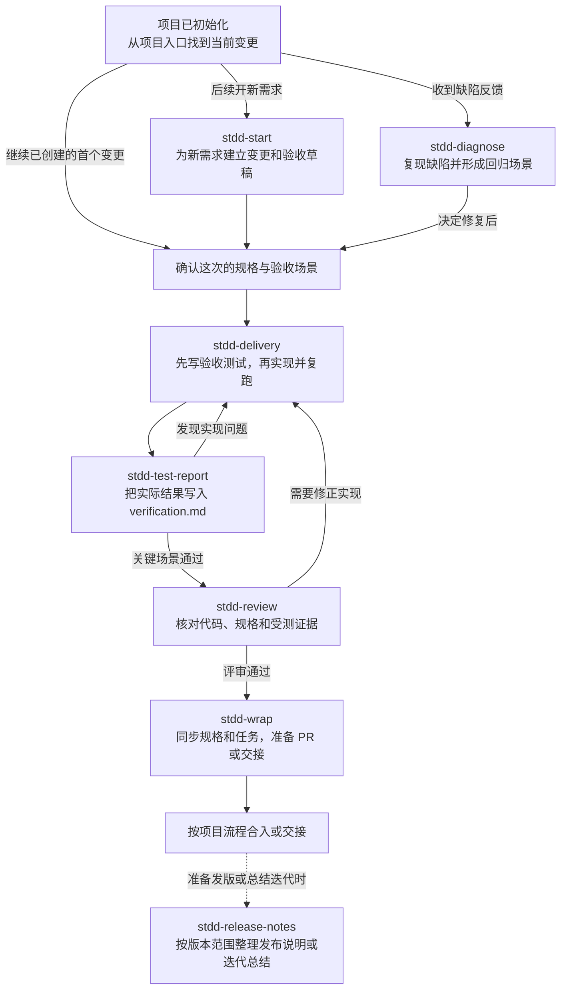

# STDD 研发工作流

产品、设计、研发和测试先从[角色导航](roles.md)打开同一份变更。按当前工具调用技能，也可以让 Agent 直接读取表中链接的 `SKILL.md`。

{{SKILL_CALLS}}

## 使用顺序

从[项目入口](project.md)找到当前变更。项目已经生成首个变更时，可以直接确认规格和验收场景。以后开新需求或处理缺陷时，按图选入口。



团队先开 PR 时，可以先用 `stdd-wrap` 准备草稿，再在 PR 中用 `stdd-review`。

## 技能速查

| 阶段 | 技能 | 工作产物 |
| --- | --- | --- |
| 开工 | [stdd-start](../../{{SKILLS_ROOT}}/stdd-start/SKILL.md) | 变更范围、规格、未决事项与第一项可执行任务 |
| 实现 | [stdd-delivery](../../{{SKILLS_ROOT}}/stdd-delivery/SKILL.md) | 与确认的场景一致的用例、实现及运行结果 |
| 排查 | [stdd-diagnose](../../{{SKILLS_ROOT}}/stdd-diagnose/SKILL.md) | 用[诊断模板](templates/diagnosis.md)记录复现、影响范围及回归场景 |
| 验收 | [stdd-test-report](../../{{SKILLS_ROOT}}/stdd-test-report/SKILL.md) | 按场景记录自动、手工及待验结果 |
| 审查 | [stdd-review](../../{{SKILLS_ROOT}}/stdd-review/SKILL.md) | 对照规格、候选差异和受测证据的发现 |
| 收尾 | [stdd-wrap](../../{{SKILLS_ROOT}}/stdd-wrap/SKILL.md) | 进度、证据和按 [PR 模板](../../.github/pull_request_template.md)整理的草稿 |
| 版本 | [stdd-release-notes](../../{{SKILLS_ROOT}}/stdd-release-notes/SKILL.md) | 按[版本说明模板](templates/release.md)整理差异、影响、兼容及验收状态 |

## 脚本

从仓库根目录使用脚本。

```sh
python3 -B scripts/new_change.py 014-order-cancellation '订单取消' --roles
python3 -B scripts/check_traceability.py
python3 -B scripts/git_range.py --merge-base main HEAD
python3 -B scripts/git_range.py v1.0.0 v1.1.0
```

- `new_change.py` 创建变更、任务与验证文件。加 `--roles` 会同时生成[规格草稿](templates/spec.md)、[体验设计](templates/ux-design.md)、[技术设计](templates/design.md)和[验收计划](templates/test-plan.md)。只需补技术设计时用 `--design`。同名的在途或已归档变更会报错。
- `check_traceability.py` 检查 `specs/` 中现行规格的 `REQ` 和 `AC` 编号、重复 ID、未知引用和缺少验收场景的需求。实际测试覆盖和手工验收结果记入 `verification.md`。可在测试名里保留场景 ID，例如 `test_ac_ship_002_at_threshold`。使用自有规格格式时，可调整或替换追溯检查。
- `git_range.py` 读取本地 Git 引用和提交差异。审查分支用 `--merge-base` 查看分叉点到候选的文件变动。比较版本时传两个实际引用，文件差异取两端快照。

## 接入项目的测试与发布流程

在工程说明里记录项目实际的构建、测试和 CI 命令。运费教学模式可用 `make trace` 查规格引用，`make test-acceptance` 跑定向验收，`make check` 跑规格检查和全部测试。工具与脚本的命令需要随项目技术栈调整。团队需要发布、动态配置或多仓编排时，可针对实际接口、环境和权限补充独立技能并关联验收证据。
