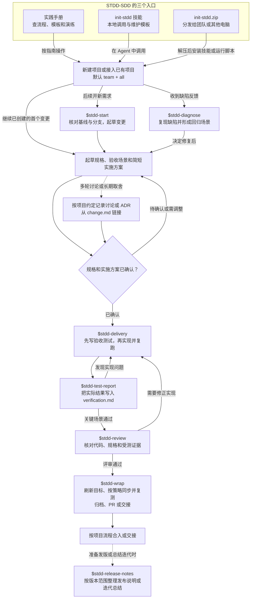

# STDD 与 SDD 实践手册

工具文档核对日期为 2026 年 11 月 17 日。企业实践与人机分工补充于 2026 年 11 月 18 日，研发技能对比及收尾同步流程完善于 2026 年 11 月 19 日。

在新项目中，可以先选一个可独立交付的业务规则。Agent 起草可观察的规范和验收场景，负责人确认影响结果的业务取舍，开发用验收测试驱动实现。每个有行为变化的 PR 都能追到改动的规则、对应场景和受测提交的结果。配套的[运费报价演练](../stdd-use-demo/README.md)用一次免运费门槛变更演示这个过程。

## 使用速查

在当前工作区可直接调用 [`$init-stdd`](.agents/skills/init-stdd/SKILL.md)，也可把 [分发包](init-stdd.zip) 交给其他同学。新项目和已有项目都可以用这个入口，默认生成 `team` 配置，由 `all` 为三种 Agent 布置技能目录。 [初始化与安装说明](.agents/skills/init-stdd/references/usage.md)



七个研发技能随 `team` 或 `demo` 生成。首个变更已有草稿时，先用现有文档完善规格和实施方案。确认后开始写测试与实现。只生成 `spec` 时，可以先评审规格、方案和验收计划。团队习惯先开 PR 时，可先用 `$stdd-wrap` 准备草稿，再在 PR 中用 `$stdd-review`。 [已完成的运费演练](../stdd-use-demo/README.md)

## 1. 方法与标准

### SDD、STDD 与相邻实践

| 实践 | 要解决的问题 | 在一次变更中的产物 |
| --- | --- | --- |
| SDD 规范驱动开发 | 把需求、边界和约束写到团队与 Agent 能共同评审的程度 | 规范、设计或计划、任务 |
| STDD 规范与测试驱动开发 | 将已经明确的行为转成可执行验收，再用它驱动实现和回归 | `REQ → AC → 测试 → 运行证据` |
| ATDD 验收测试驱动开发 | 让业务、开发和测试共同定义足以验收的外部行为 | 开发前达成共识的示例和验收测试 |
| BDD 与 Specification by Example | 用共享语言和具体示例发现歧义，持续维护业务规则 | 示例、决策表或 Given/When/Then 场景 |
| TDD 测试驱动开发 | 通过短反馈循环推进代码设计和实现 | 写测试并看到预期失败，写最小实现使其通过，再重构 |

本手册沿用 STDD 作为组合实践的工作名称。公开的同名项目采用不同的文件约定和流程。上述做法可以同时使用，例如先开一场产品、开发、测试的示例评审，随后用一个功能级验收用例驱动交付，在实现困难的内部逻辑时继续用单元级 TDD。 [Agile Alliance 的 ATDD 定义](https://agilealliance.org/glossary/atdd/) · [Gojko Adzic 的 Specification by Example](https://www.manning.com/books/specification-by-example) · [Martin Fowler 的 TDD 说明](https://martinfowler.com/bliki/TestDrivenDevelopment.html)

快手沈浪的公开分享把 SDD、端到端 Skill、研发与业务知识入库一起纳入工程实践。用于自己的项目时，可以把业务规则留在仓库的能力规范中，把团队反复执行的交付步骤封装成 Skill。 [快手沈浪分享原文](https://mp.weixin.qq.com/s/_Q0UOErTkefleqGpOfnL3A)

### 可直接采用的规范

| 规范或写法 | 适用范围 | 实际怎么用 |
| --- | --- | --- |
| ISO/IEC/IEEE 29148:2018 | 需求工程过程和信息项 | 大型项目或有正式交付要求时，用于设计需求基线、评审和追溯。 [ISO 目录](https://www.iso.org/standard/72089.html) |
| ISO/IEC/IEEE 29119 系列 | 软件测试过程、文档和技术 | 第 2 部分参考测试过程，第 3 部分参考测试文档，第 4 部分参考测试设计技术。 [ISO 工作组说明](https://committee.iso.org/sites/jtc1sc7/home/projects/flagship-standards/isoiecieee-29119-series.html) |
| EARS | 用结构化自然语言写需求 | 用「当触发条件发生时，系统应产生某个可观察结果」写一条规则。状态、可选特性和异常可以各自明确触发条件。 [EARS 作者指南](https://alistairmavin.com/ears/) · [Kiro 的用法](https://kiro.dev/docs/specs/feature-specs/requirements-first/) |
| Given/When/Then 与 Gherkin | 用示例表达验收场景 | 先在 Markdown 中讨论具体样例。选择 Cucumber 时让 `.feature` 和 step definitions 承担执行。 [Gherkin 参考](https://cucumber.io/docs/gherkin/reference/) |
| OpenAPI 与 JSON Schema | HTTP 接口和数据结构契约 | 将契约放入可版本化文件，在 CI 校验结构及消费者所依赖的行为。业务规则通过需求链接和测试表达。 [OpenAPI](https://spec.openapis.org/oas/latest.html) · [JSON Schema](https://json-schema.org/specification) |
| RFC 2119、8174（BCP 14） | 英文协议规范的强制程度 | 需要时声明 `MUST`、`SHOULD`、`MAY` 的约定，并保持一致。中文业务规范可用统一的「必须」「建议」「允许」。 [RFC Editor](https://www.rfc-editor.org/info/bcp14/) |

轻量项目从**稳定编号、可观察需求和具体样例**开始。团队选用正式标准时，根据合同或组织要求落实对应过程和信息项。

## 2. 一次变更怎样从需求走到合并

| 阶段 | 主要工作 | 进入下一阶段的条件 |
| --- | --- | --- |
| 1. 确定范围 | 读取现行规范与代码，找出调用方、现状、目标和明确排除的范围 | 需求负责人确认目标，关键未决问题可定位到具体行为 |
| 2. 定义验收 | 给行为分配 `REQ-*`，用 `AC-*` 描述主路径、边界、失败和需要保留的行为 | 需求方确认预期输出或副作用，开发能据此写断言 |
| 3. 确认实施方案 | 记录修改入口、关键取舍和验收方式，按一个可验收结果拆任务。复杂变更补设计和契约 | 实施方案得到确认，任务关联场景 ID、依赖和完成条件 |
| 4. 写测试并观察失败 | 对本次变化从稳定入口写验收或回归测试，在可运行的旧实现上先执行 | 失败来自行为断言和预期差异。记录命令和失败内容 |
| 5. 实现、通过、重构 | 完成当前切片，复跑定向测试，通过后重构，再跑完整检查 | 新用例和原有回归都通过，规格与契约已同步 |
| 6. 评审、合并和归档 | 评审选例、断言和证据，更新主分支现行规范，归档本次变更 | PR 可追溯到已确认的规格、受测提交和 CI。手工或延后验证有记录和负责人 |

**怎么写规则。** 例如「小计达到 9,900 分时运费为 0 分」。场景分别取门槛前一分、恰好达到、超过一分。先把金额单位、精度、错误、观察点写清，再讨论实现。多个输入共同决定结果时可以用决策表，状态复杂时用起始状态、事件、目标状态和副作用表达。

**怎么认定 Red。** 在旧实现或可调用的最小入口上运行刚写的用例，核对失败触发的输入和断言。若因导入、测试数据或依赖启动失败，先修复测试环境再采集行为证据。修 Bug 时先用原实现复现报告中的行为，再验证修复后预期。若一个新用例在旧实现上已通过，核对它保护的是既有行为还是发生了选例遗漏，并如实记录。

**怎么控制测试范围。** 选择能完整观察业务规则的最低适用接口。纯函数规则直接测公开函数，贯穿数据库事务的规则用集成测试，跨服务兼容用契约或集成测试，浏览器端到端测试留给关键旅程。性能等约束写清数据规模、并发、环境、观测窗口、指标和阈值。短而稳定的检查放 PR，成本高的场景可放定时或发布检查，并在验收记录标明证据状态。 [Practical Test Pyramid](https://www.martinfowler.com/articles/practical-test-pyramid.html)

**怎么处理需求变更。** 评审后口径变更时先更新需求和场景，写明理由，再同步测试和实现。评审时特别检查删除或放宽断言、`skip`、mock 返回值与规格是否一致。同一能力被并行修改时，合并者以最新基线核对增量和 ID，并重新运行两个变更涉及的场景。后续接手的人可从 PR 或归档查到当时的决定和证据。

### 评审规则与验收证据

把**评审规则、业务验收预期、运行证据**分别管好。Claude Code 团队让评审读取目标分支或默认分支的 `REVIEW.md`，并将评审结果绑定到具体提交。项目可据此从受保护的目标分支读取评审规则，对评审规则和 CI 工作流的修改配置专门的维护者评审。业务验收预期仍可随需求变更，修改时保留已确认的规格差异和决策记录，即便规范、测试和实现放在同一个 PR。 [Claude Code 团队的验证实践](https://claude.dev/blog/how-the-claude-code-team-thinks-about-verification/) · [GitHub 代码所有者](https://docs.github.com/en/repositories/managing-your-repositorys-settings-and-features/customizing-your-repository/about-code-owners)

验收记录写明规格版本、实际受测 SHA、场景 ID、运行环境和观察结果。跨仓库记录各仓受测 SHA。多次推送后，以当前合并候选的检查为准，按现有门禁重跑受影响的验证。日常改动先跑定向检查和回归。权限、数据迁移、公共契约等高影响变更，可以让另一人或新会话按已确认的场景检查 diff，并独立重跑关键用户路径。人工批准沿用团队现有规则。 [Claude Code 团队的代码评审](https://claude.dev/blog/solving-code-review-at-anthropic/) · [Anthropic 长任务工程实验](https://www.anthropic.com/research/harness-design-long-running-apps)

例如，将免运费门槛从 99 元改为 129 元时，Agent 可以同时调整规范、断言和实现。评审时需要查到业务负责人确认的门槛，核对 12,899 和 12,900 分的断言，同时确认原有输入校验仍有用例覆盖。若测试变绿是因为删除了门槛断言，按已确认的验收预期可以直接指出证据缺口。

## 3. 工具与脚手架选型

### 规范和流程工具

| 起点 | 适合的项目 | 原生流程和文件 | 接上 STDD 的做法 |
| --- | --- | --- | --- |
| [init-stdd 初始化器](.agents/skills/init-stdd/references/usage.md) | 新项目或已有项目接入，团队希望沿用自身技术栈 | `team` 生成规格、四角色文档、研发技能与脚本。`demo` 加运费示例、验收测试和 CI | 从一个可验收切片开始，用项目测试入口建立证据 |
| GitHub Spec Kit | 希望规范、设计和任务有明确阶段，并由通用编码 Agent 协作 | `.specify/memory/constitution.md` 管项目原则，常见功能目录含 `spec.md`、`plan.md`、`tasks.md`。内置流程包含规范、计划、任务、实现和收敛，可加澄清、检查清单和一致性分析。 [快速入门](https://github.github.com/spec-kit/quickstart.html) · [文件与升级](https://github.github.com/spec-kit/upgrade.html) | 在项目原则和任务切片中约定测试先行及场景 ID。`checklist` 审的是需求质量，`analyze` 检查文档一致性，运行证据来自项目的测试工具 |
| Fission AI OpenSpec | 已有仓库需要区分长期行为和每次增量，或多项变更并行 | `openspec/specs/` 管现行规范，`openspec/changes/` 管 proposal、增量规范、design 和 tasks。归档将增量合入现行规范并保留变更记录。 [目录与初始化](https://openspec.dev/docs/setup) · [官方流程](https://openspec.dev/docs/quickstart) | 用同一组场景 ID 对应 `tests/`，在归档前跑验收与回归。工具校验用于格式和增量流程，实际行为由测试验证 |
| AWS Kiro Specs | 团队已有 Kiro，希望在编辑器中评审规格和执行任务 | `.kiro/specs/<feature>/` 可放 `requirements.md` 或 `bugfix.md`、`design.md`、`tasks.md`。长期项目上下文可放 `.kiro/steering/`。 [Kiro Specs](https://kiro.dev/docs/specs/) · [文件路径](https://kiro.dev/docs/ide/editor/markdown-review/) · [Steering](https://kiro.dev/docs/steering/) | 在需求中写 EARS 和验收例子，在任务中安排测试先行，CI 复用项目的测试运行器 |

社区中有两个值得查阅的同名实践。Frank Heikens 的 STDD 仓库提供规范与测试分类、追溯模板、验收用例生成与校验脚本，以及一个从规范和测试出发重新生成实现的方法。`leonai42/stdd` 提供流程状态、Skill 安装、验证、追溯和归档等 CLI，并定义了它自己的阶段与审批规则。可以参考两者的模板和自动校验，再按本团队的变更风险选用相应机制。 [fheikens/stdd](https://github.com/fheikens/stdd) · [leonai42/stdd](https://github.com/leonai42/stdd/blob/master/README_EN.md)

### 初始化示例

**Spec Kit 与 Codex。** 在终端安装并初始化新项目。

```sh
uv tool install specify-cli
specify init my-project --integration codex
```

在已有仓库接入时，先建立可供评审的 Git 基线，再在仓库根目录运行 `specify init --here --force --integration codex` 并检查生成的 diff。`--force` 允许在非空目录初始化，可能替换冲突的工具文件。 [已有仓库接入指南](https://github.github.com/spec-kit/how-to/existing-projects.html)

在 Codex 聊天里依次调用 `$speckit-constitution`、`$speckit-specify`、`$speckit-plan`、`$speckit-tasks`、`$speckit-implement`、`$speckit-converge`。较复杂的变更按官方完整流程，在 Specify 后加入 Clarify、Plan 后加入 Checklist、Tasks 后加入 Analyze。多个进行中的功能要核对当前 feature 的解析结果，官方文档说明它可由 `.specify/feature.json` 或 `SPECIFY_FEATURE_DIRECTORY` 指定。 [安装说明](https://github.github.com/spec-kit/installation.html) · [Codex 集成](https://github.github.com/spec-kit/integrations/codex.html) · [流程和当前 feature](https://github.github.com/spec-kit/quickstart.html)

**OpenSpec 与 Codex。** 在目标仓库根目录初始化并选择 Codex。下例走官方 npm 安装路径，团队落地时记录选定版本。

```sh
npm install -g @fission-ai/openspec@latest
openspec init
```

OpenSpec 2.x 在 Codex 聊天中可用 `$openspec-explore`、`$openspec-propose`、`$openspec-apply-change`、`$openspec-archive-change`。评审提案并确认测试证据后再归档。已有 1.x 项目的 `/opsx:*` 是该版本的调用形式，采用本地初始化输出和对应版本的文档。 [OpenSpec 官方仓库](https://github.com/Fission-AI/OpenSpec) · [初始化与版本差异](https://openspec.dev/docs/setup)

**Kiro。** 在 Specs 面板创建 Feature Spec，选择 Requirements-First，按要求、设计、任务的顺序评审。方案已经明确时，可从 Design-First 进入。已有缺陷用 Bugfix Spec 表达当前、预期及需保留的行为。 [Kiro Specs 工作流](https://kiro.dev/docs/specs/)

### 测试执行工具

| 验证目标 | 可选工具 | 何时引入 |
| --- | --- | --- |
| 函数、业务模块、数据边界 | Python `unittest` 或 pytest | 新项目从技术栈已有的运行器开始。阈值、无效输入和组合条件可用参数化测试。 [unittest](https://docs.python.org/3/library/unittest.html) · [pytest 参数化](https://docs.pytest.org/en/stable/how-to/parametrize.html) |
| 共读并执行业务示例 | Cucumber | 业务和工程共同维护 `.feature`，且团队愿意维护 step definitions。 [Cucumber](https://cucumber.io/docs/gherkin/reference/) |
| 数据库、队列等真实依赖 | Testcontainers | 验收依赖约束、序列化、事务或消息行为时，为测试启动隔离依赖。 [Testcontainers](https://testcontainers.com/) |
| 多服务接口和发布兼容 | Pact、Schemathesis | Pact 验证消费者与提供者约定。Schemathesis 从 API schema 生成请求以检查实现的契约表现。 [Pact](https://docs.pact.io/) · [Schemathesis](https://schemathesis.readthedocs.io/en/stable/) |
| 浏览器关键链路 | Playwright | 登录后完成一次核心任务等端到端体验。优先断言用户可见行为，用稳定定位和隔离数据。 [Playwright 最佳实践](https://playwright.dev/docs/best-practices) |
| 广泛输入或领域不变量 | Hypothesis 等属性测试工具 | 有明确定义的不变量时使用，例如金额结果非负、重复提交不增加副作用。用明确的边界样例保留业务语义。 [Hypothesis](https://hypothesis.readthedocs.io/en/latest/) |
| PR 门禁 | 已有 CI 与分支保护 | 本地和 CI 复用 `make check` 或包管理器等入口，将关键工作流配置为必过检查。 [GitHub 分支保护](https://docs.github.com/en/repositories/configuring-branches-and-merges-in-your-repository/managing-protected-branches/about-protected-branches) |

替换示例技术栈时，保留场景 ID、稳定入口和定向测试命令。TypeScript 可用 Vitest 的 `vitest run`，Java 可由 Maven 或 Gradle 运行 JUnit，Go 可直接用 `go test ./...`。测试文件按语言惯例放置，例如 Go 的 `*_test.go` 可与实现同目录。 [Vitest](https://vitest.dev/guide/) · [JUnit](https://docs.junit.org/current/user-guide/) · [Go testing](https://pkg.go.dev/testing)

## 4. 仓库目录与每份 Markdown 的职责

下列结构适用于带测试入口的轻量项目。讨论目录、ADR 目录、`contracts/` 和更多测试分层随需要添加。演练中将免邮门槛从 99 元调整到 129 元的记录位于 `changes/archive/002-free-shipping-threshold/`。 [演练的项目入口](../stdd-use-demo/docs/stdd/project.md)

```text
project/
├── README.md                              # 人的启动、使用与测试入口
├── AGENTS.md                              # Agent 的仓库入口、命令与约束
├── docs/
│   ├── engineering.md                     # 工程原则与交付规则
│   ├── discussions/                       # 跨角色或多轮讨论，按需
│   ├── decisions/                         # 长期架构决策，沿用已有的 adr/ 或 decisions/
│   ├── stdd/project.md                     # 项目目标与四角色入口
│   ├── stdd/workflows.md                   # 研发阶段、技能与脚本入口
│   └── stdd/templates/                    # 各份 Markdown 的复制模板
├── specs/<capability>/spec.md             # 主分支现行的可观察行为
├── changes/
│   ├── <id>-<slug>/                        # 当前变更
│   │   ├── change.md                      # 动机、范围与增量，链接 REQ / AC
│   │   ├── spec.md                        # 本次需求与验收场景草稿
│   │   ├── ux-design.md                   # 体验与交互状态
│   │   ├── design.md                      # 复杂变更的实现设计，按需
│   │   ├── tasks.md                       # 按验收切片的任务与进度
│   │   ├── test-plan.md                   # 验收计划和测试入口
│   │   └── verification.md                # 场景、证据与运行结果
│   └── archive/<id>-<slug>/                # 已完成变更记录
├── contracts/                             # OpenAPI 或事件 schema，按需
├── <application>/                        # 生产代码，按技术栈组织
├── tests/acceptance/                      # 独立运行的验收用例
├── .agents/skills/<skill>/SKILL.md          # 开工、交付、自测、审查、收尾等
├── scripts/                               # 初始化变更、查规格引用、读取 Git 差异
├── .github/pull_request_template.md
├── .github/workflows/check.yml
└── Makefile                               # 本地与 CI 的同一入口
```

| 文件 | 至少写什么 | 什么时候更新 |
| --- | --- | --- |
| [README.md](.agents/skills/init-stdd/assets/base/README.md) | 项目用途、首次运行和验证命令、关键文档入口 | 启动、测试命令或入口变化 |
| [AGENTS.md](.agents/skills/init-stdd/assets/base/AGENTS.md) | 代码入口、必跑命令、修改行为要读什么、证据放哪 | Agent 的日常工作约定变化 |
| [docs/engineering.md](.agents/skills/init-stdd/assets/base/docs/engineering.md) | ID、测试分层、规范归属、评审及归档规则。采用 Spec Kit 时长期原则可放 `constitution.md` | 团队新增或调整长期规则 |
| [spec.md](.agents/skills/init-stdd/assets/starter/docs/stdd/templates/spec.md) | 范围、带 ID 的规则、验收示例、必要的可测约束和契约引用 | 同一 PR 内随已确认的可观察行为变化而更新 |
| [change.md](.agents/skills/init-stdd/assets/starter/docs/stdd/templates/change.md) | 为什么改、改哪些规则、旧行为和目标行为、未决问题 | 首次提案和关键口径变化 |
| [design.md](.agents/skills/init-stdd/assets/starter/docs/stdd/templates/design.md) 或 `plan.md` | 入口、实现方案、架构权衡、兼容性、迁移和回滚 | 方案影响实现、兼容或运维时。长期设计决策可独立为 [ADR](.agents/skills/init-stdd/assets/starter/docs/stdd/templates/adr.md) |
| [ux-design.md](.agents/skills/init-stdd/assets/starter/docs/stdd/templates/ux-design.md) | 用户流程、界面状态及对应验收场景 | 需要评审用户体验或补原型时 |
| [tasks.md](.agents/skills/init-stdd/assets/starter/docs/stdd/templates/tasks.md) | 简短实施方案、确认记录，以及按可验收切片写任务、AC、依赖与完成条件 | 方案、确认状态、任务拆分或进度变化 |
| [test-plan.md](.agents/skills/init-stdd/assets/starter/docs/stdd/templates/test-plan.md) | 场景、输入、验证层级、操作和预期 | 范围、场景或测试入口变化时 |
| [verification.md](.agents/skills/init-stdd/assets/starter/docs/stdd/templates/verification.md) | ID 到用例的映射、命令、运行环境和结果，或 CI/手工证据链接 | 定向测试、回归或手工验收实际执行后 |
| [SKILL.md](.agents/skills/init-stdd/assets/starter/.agents/skills/stdd-delivery/SKILL.md) | 使用场景、应读文件、步骤、检查和交付物 | 交付或评审流程出现需要固化的重复经验 |
| [PR 模板](.agents/skills/init-stdd/assets/starter/.github/pull_request_template.md) | 变更范围、REQ/AC、验收证据、待验证事项 | 需要新增合并审查字段时 |

**给每类信息一个权威位置。** 规范描述主分支可观察行为，API 字段和格式在契约里维护，变更记录保存决策与前后差异，测试代码保存可执行断言。采用某个工具后用它生成的原生目录承接相应职责，其他入口用链接指向规范。若 `.feature` 是由业务和工程共同维护的场景正文，`spec.md` 可按需求 ID 链接场景。生产版本通过发布标记或部署记录关联对应提交。

**小变更可合并文档。** 一个低风险 Bug 可以在 PR 里写清旧行为、目标行为、场景 ID 和回归证据，同步相应规范。时间较长的功能保留独立变更目录，复杂迁移补设计。单仓按能力组织规格，多个服务可以就近维护各自的能力规范。跨仓则指定一个所有者维护共享契约，消费仓库引用版本，并在变更记录里写生产者、消费者、兼容窗口和发布顺序。

**讨论与 ADR 按影响范围放置。** 单次待决事项留在 `change.md`。需要多轮评审、跨角色讨论或跟踪备选方案时，沿用项目讨论目录，缺省用 `docs/discussions/`。长期决定查已有 ADR 和项目约定，沿用 `docs/adr/` 或 `docs/decisions/`。首次需要且两处均不存在时再建 `docs/adr/`。在 `change.md` 链接相关记录，归档后修正变更与外部文档之间的相对链接。 [讨论模板](.agents/skills/init-stdd/assets/starter/docs/stdd/templates/discussion.md) · [演练中的关联记录](../stdd-use-demo/changes/archive/002-free-shipping-threshold/change.md)

### 跨需求复用的约定与单次变更

沈剑的直播纪要把 SDD 拆成产品需求、原型设计和技术架构三类基线，以及每次需求据此生成的产物。这一思路可接到现有脚手架。先沿用已有文档和模板，当某类约定反复出现时再独立维护，并由相应领域负责人更新。 [架构师之路直播纪要](https://mp.weixin.qq.com/s/9MKGsp0NgxZZNeByCLCEbQ)

| 约定 | 跨需求可复用的内容与位置 | 本次变更引用后产出什么 |
| --- | --- | --- |
| 需求写法 | 使用 `docs/stdd/templates/spec.md`。约定范围、非目标、验收样例和兼容要求的写法 | 在 `change.md` 写增量，按需附详细规格。确认后将受影响的长期行为更新到 `specs/<capability>/spec.md` |
| 产品体验 | 有重复设计约束时引用已有设计系统，或在 `docs/ux-guidelines.md` 写组件、交互和可访问性约定 | 仅在界面变化需要时附原型链接，在规格里列出可验收的空态、异常态等用户可见行为 |
| 技术架构 | 在 `docs/engineering.md` 或已有架构文档写服务边界、契约兼容、测试和迁移约定，长期决策引用 ADR | 需要技术取舍时写 `changes/<id>-<slug>/design.md`，链接受影响的契约、实现方案和发布顺序 |

`change.md` 可以链接本次适用的约定。遇到例外，记录影响、决定人和后续处理。只有确认过的通用做法才回写长期约定。开始实现前，把已确认的规则、相关约定和可运行的检查组合成 `tasks.md` 中的一个验收切片。脚手架沿用 `design.md` 表示单次**技术设计**，产品体验约定随现有设计系统维护。

## 5. Agent 技能与人机分工

`AGENTS.md` 适合短而稳定的仓库规则。`SKILL.md` 适合按任务触发的工作流。Codex 会按工作目录和仓库根之间的层级发现仓库说明与 `.agents/skills/`。Agent Skills 规范要求 `name` 和 `description`，可按需要增加 `references/` 或 `scripts/`。选到技能后再读取其正文和相关资源。 [Codex 的 AGENTS.md 加载规则](https://learn.chatgpt.com/docs/agent-configuration/agents-md) · [Codex 技能目录](https://learn.chatgpt.com/docs/build-skills) · [Agent Skills 规范](https://agentskills.io/specification)

### 谁起草 谁决定 谁验收

- **Agent 可以起草。** 让 Agent 先读原始需求、现行规范、已有行为和测试，再起草变更、候选场景和待定事项。草稿标明来源与假设。代码里的现状和用户想要的行为有差异时，列出具体样例，便于负责人判断。
- **负责人确认会改变结果的决定。** 需求负责人确认业务规则、范围和验收预期。涉及设计取舍、架构例外、发布风险时，请对应负责人决定，记录到 `change.md` 或工单。例行工作沿用已确认的约定，关键决策集中到实际需要判断的场景。
- **开发交付证据，评审者核对实际结果。** 用测试、真实页面或观察到的系统状态验证场景。复杂任务可把实现与验收交给不同会话，按同一份已确认的规格和验收场景复核。 [Claude Code 最佳实践](https://code.claude.com/docs/en/best-practices) · [Anthropic 的独立评估实验](https://www.anthropic.com/research/harness-design-long-running-apps)

日常交付一个已确认的切片可以使用 `$stdd-delivery`。跨会话时可在 `tasks.md` 和 `verification.md` 留下已通过的切片、提交、复跑命令、阻塞点和下一步。接手时先核对当前提交和可运行状态。 [Anthropic 长任务交接实践](https://www.anthropic.com/research/effective-harnesses-for-long-running-agents)

### 从既有研发技能接入脚手架

编写脚手架时参考了覆盖开工到版本整理的团队研发技能。脚手架复用这些流程的关键输入和产物。Markdown 保存规则、已决事项和证据，Skill 调度需要上下文判断的步骤，脚本提供可重跑的初始化、检查和 Git 查询。 [演练项目的研发技能与脚本入口](../stdd-use-demo/docs/stdd/workflows.md)

| 原技能 | 脚手架里的做法 |
| --- | --- |
| `dev-start` | `$stdd-start` 刷新已确认的远端基线，记录基线 SHA、真实合入目标、同步策略、测试入口与已知失败，再起草规格及实施方案。分支方式沿用项目约定 |
| `branch-review` | `$stdd-review` 固定目标与候选 SHA，从实际候选读取代码，沿调用方及删除影响检查增量。工作区审查包含相关未跟踪文件，报告注明未深入审查和未实测范围 |
| `test-report` | `$stdd-test-report` 按受影响场景组织自动与手工验收，记录用例数量及失败、阻塞、跳过状态，复用旧产物前核对版本。报告不修改业务代码，也不把零条预期用例或未验场景计为通过 |
| `dev-wrap`、`ptal` | `$stdd-wrap` 承接文档同步、目标刷新、按策略 rebase、冲突处理、依赖同步和复测，在 `verification.md` 记录最终受测内容。项目约定决定共享历史、squash 和推送方式 |
| `issue-diagnose` | `$stdd-diagnose` 核对反馈时段、时区、资料来源、应用版本与本地代码差异，区分已复现事实及根因假设，再建立回归场景。反馈平台由项目接入 |
| `release-diff`、`weekly-summary` | `$stdd-release-notes` 固定比较版本，区分快照差异和时间窗内的主线合入记录。合并同功能条目，同时核对修复、撤回、依赖及兼容变化，并关联验收状态 |
| `dynamic-config`、`release-in-portal`、`release-in-ota` | 项目需要时补配置契约或平台发布 Skill，使用项目自己的类型、命令、发布规则和验收 |
| `mono-workspace` | 多仓任务按需接入既有技能与其目录生成器，继续用同一规格和各仓受测 SHA 做联合验收 |

原 `dev-wrap` 把 rebase 和提交前检查交给 `ptal`。通用脚手架直接在 `stdd-wrap` 承接这些步骤，项目无需额外安装 `ptal` 或其检查脚本。参考项目的固定分支、任务号格式、Bun 命令、日志规则、迭代周历和发布接口由接入项目自行约定。`stdd-delivery` 继续负责已确认切片的测试先行与实现；无需为技能对齐另建重复流程。

默认收尾先刷新真实目标并固定 SHA，再根据提交关系跳过、快进或 rebase。工作区需可安全整理；共享的已发布历史按项目合并方式处理。冲突依据双方意图和已确认场景解决，无法决定时保留现场及续接入口。同步、冲突处理及提交整理之后，以最终候选重跑适用检查，记录真实受测版本。无远端、离线、中途交接或项目另有策略时注明实际状态。 [Git 工作方式](.agents/skills/init-stdd/assets/base/docs/stdd/git-workflow.md#收尾同步)

技能提供 Agent 的操作步骤和记录要求。现有 `git_range.py` 提供差异查询。项目检查、验收证据和 ZIP 发布门禁见第 7 节。初始化或完整升级后，初始化器把采用的版本写入项目根目录的 `.stdd-version`。后续用新版脚本的 `--upgrade --dry-run`，按记录的发布标签获取旧包并预览差异。旧项目确认实际采用的版本后可以用 `--record-version` 补录，手头有旧包时可用 `--from-bundle`。项目和新版均有改动的文件会标为 `MERGE`，团队可结合上游差异合并后运行原有检查。 [升级说明](.agents/skills/init-stdd/references/usage.md#升级已初始化的项目)

可直接把下面的任务发给仓库里的 Codex。

```text
用 $stdd-delivery 交付 changes/014-order-cancellation 中已确认方案和验收口径的 AC-ORDER-003。
先读现行规范和受影响的契约，补一个能从公开入口观察行为的回归测试。
在旧实现上运行它并记录失败断言，再实现。跑定向测试和 make check，
将命令、结果与测试路径写入 verification.md。发现验收口径冲突时，
列出具体行为和受影响的 ID，继续处理独立且已明确的部分。
```

如果交付的产品本身包含 Agent，在常规测试之外按场景管理评测样本。给样本记录初始状态、允许使用的工具、预期结果与判定方式。能从系统状态或返回值判断时采用确定性检查，开放性结果用有示例的评分准则并请人抽检。对需要稳定重复运行的场景做多次试验，记录单次表现和全部通过的比例。 [Anthropic Agent 评测指南](https://www.anthropic.com/research/demystifying-evals-for-ai-agents)

## 6. 初始化项目并验证第一条规则

新项目或已有仓库可以用 [`$init-stdd`](.agents/skills/init-stdd/SKILL.md) 初始化。给项目名、目标或一个已有工单即可，由任一角色发起。`--profile` 决定只生成文档、带上研发工具或包含可运行的教学示例。默认用 `team` 生成团队协作内容，用 `all` 一次生成 Codex、Claude Code 和 Qoder 的技能目录。 [初始化技能用法](.agents/skills/init-stdd/references/usage.md) · [分发包](init-stdd.zip)

已有项目可从下一项真实变更接入。用现有代码与测试记录相关行为和运行基线，预览脚手架的新增与保留项，再起草目标行为、应保留的约束和验收计划。 [已有项目接入流程](.agents/skills/init-stdd/references/existing-project.md)

1. 按[运费报价演练](../stdd-use-demo/README.md)初始化一个 `demo` 副本，然后运行 `make check` 验证 99 元免邮基线。示例使用 Python 标准库，应用代码、技能目录和 `.github/` 可一起版本化。
2. 对照 [REQ-SHIP-001](../stdd-use-demo/changes/archive/002-free-shipping-threshold/spec.md#req-ship-001) 和 [AC-SHIP-001](../stdd-use-demo/changes/archive/002-free-shipping-threshold/spec.md#ac-ship-001)，先修改验收用例，再把门槛改成 129 元。定向测试会先在旧实现上捕获两处差异，改动后复跑。 [验收用例](../stdd-use-demo/tests/acceptance/test_shipping_quote.py) · [本地验收记录](../stdd-use-demo/changes/archive/002-free-shipping-threshold/verification.md)
3. 为真实项目挑一项范围清晰的变更，复制 `change.md` 和 `spec.md` 模板，拉需求方一起写至少一个正常和一个相关边界或失败示例。定向命令测试这些场景，完整命令验证既有行为。
4. 合并前从一个 `REQ` 随机追到 `AC`、测试和 CI，再从一条失败用例反追业务规则。覆盖差距可以从受影响场景中统计，按已自动验证、已手工验证和待验证记录。评审仍要核对断言是否能区分正确与错误的实现。

跨前后端的验收可以用同一份清单记录默认行为、筛选分页、错误返回和租户隔离。证据中标明规格版本、前后端各自的受测提交、浏览器版本、测试数据和逐项观察结果。

首轮试点可选连续三到五个小变更。用同类需求作基线，记录从开始到验收的时间，并单列等待评审、CI 和联调的时间。结合验收口径返工、上线后遗漏和撤回情况，判断下一步该改哪一环。将实际漏掉的规则补成回归用例，反复出现的评审问题再写入评审规则。变更涉及多个仓库时，先把契约所有权和版本兼容跑通。

## 7. 后续待完善的测试与门禁

本仓库已接通分发 ZIP 的发布门禁。项目检查和验收证据门禁仍待完善。不同项目的测试基础、权限和联调环境有差异，当前先用各项目已有流程完成验收，再根据试点遇到的问题决定优先补哪一项。

| 门禁 | 状态 | 当前做法与后续方向 |
| --- | --- | --- |
| 项目检查门禁 | 待完善 | 沿用项目已有的构建、测试、合并和发布规则，约定各阶段的必跑检查。后续提供可从终端或流水线调用的统一入口，必跑套件发现零条用例时应失败 |
| 验收证据门禁 | 待完善 | 用 `test-plan.md` 和 `verification.md` 记录场景、受测版本、环境和实际结果。后续核对必验场景的自动测试、联调或手工验收证据，并按项目规则控制合入或交付 |
| 分发 ZIP 发布门禁 | 已接入本仓库 | 发布前核对标签、文档入口、技能源码和 ZIP 逐文件内容，运行三种初始化配置、已有文件保留、路径冲突和运费演练。发布后从「下载最新版」实际下载，校验 SHA-256 并记录标签所指的提交 |

维护者通过 GitHub Actions 的 **Release init-stdd** 发布。发布前检查通过后，工作流才上传 ZIP 并设为 Latest。发布后检查结果写入运行摘要，也可以用同一工作流复核当前线上版本。 [仓库发布步骤](../AGENTS.md#三个入口的同步与发布) · [发布工作流](../.github/workflows/release-init-stdd.yml)

默认 `team` 的追溯脚本检查现行规格中的 `REQ → AC` 关系。业务验收以项目实际执行的测试或联调证据为准。集成条件尚未具备时，将必验场景如实记为待验证。
