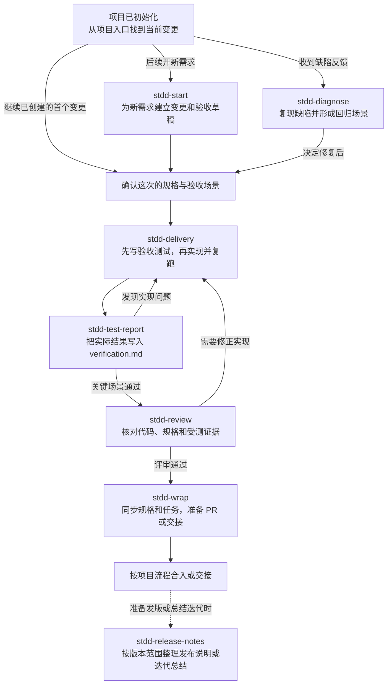

# STDD 研发工作流

产品、设计、研发和测试先从[角色导航](roles.md)打开同一份变更。仓库内还带有以下 Skill，接入支持 Agent Skills 的工具后可按任务调用。

## 使用顺序

从[项目入口](project.md)找到当前变更。项目已经生成首个变更时，可以直接确认规格和验收场景。以后开新需求或处理缺陷时，按图选入口。



团队先开 PR 时，可以先用 `stdd-wrap` 准备草稿，再在 PR 中用 `stdd-review`。

## 技能速查

| 阶段 | 技能 | 工作产物 |
| --- | --- | --- |
| 开工 | [$stdd-start](../../.agents/skills/stdd-start/SKILL.md) | 变更范围、规格、未决事项与第一项可执行任务 |
| 实现 | [$stdd-delivery](../../.agents/skills/stdd-delivery/SKILL.md) | 与确认的场景一致的用例、实现及运行结果 |
| 排查 | [$stdd-diagnose](../../.agents/skills/stdd-diagnose/SKILL.md) | 复现记录、影响范围及回归场景 |
| 验收 | [$stdd-test-report](../../.agents/skills/stdd-test-report/SKILL.md) | 按场景记录自动、手工及待验结果 |
| 审查 | [$stdd-review](../../.agents/skills/stdd-review/SKILL.md) | 对照规格、候选差异和受测证据的发现 |
| 收尾 | [$stdd-wrap](../../.agents/skills/stdd-wrap/SKILL.md) | 进度、证据和 PR 草稿 |
| 版本 | [$stdd-release-notes](../../.agents/skills/stdd-release-notes/SKILL.md) | 版本差异、影响、兼容及验收状态 |

从仓库根目录使用脚本。

```sh
python3 -B scripts/new_change.py 014-order-cancellation '订单取消' --roles
python3 -B scripts/check_traceability.py
python3 -B scripts/git_range.py --merge-base main HEAD
```

`new_change.py` 创建变更、任务与验证文件。加 `--roles` 会同时生成[规格草稿](templates/spec.md)、[体验设计](templates/ux-design.md)、[技术设计](templates/design.md)和[验收计划](templates/test-plan.md)。`check_traceability.py` 校验采用本脚手架格式、位于 `specs/` 中的现行规格 ID 和引用。`git_range.py` 使用本地 Git 引用，例中的 `main` 应替换为实际目标分支。项目的构建与测试使用仓库自己的命令，运费教学模式可以运行 `make check`。
